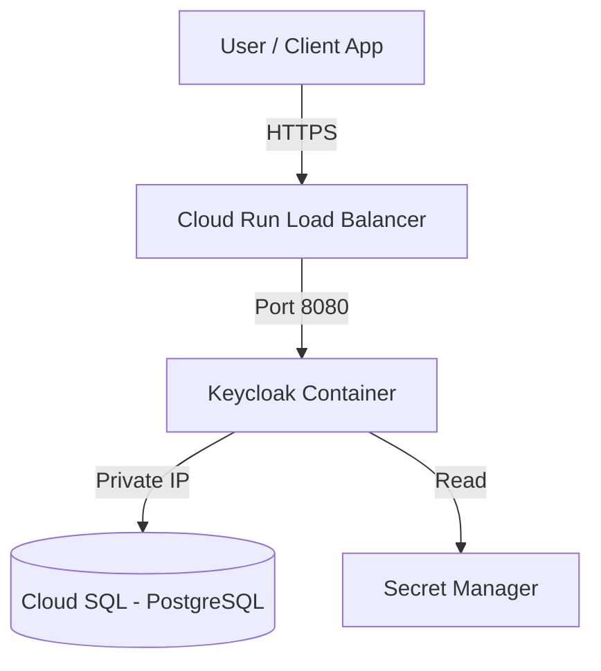

# Architecture - Project 1 (Identity)

**CLASSIFICATION: INTERNAL**

## Topology

## Components

### 1. Keycloak (Application)
*   Runs as a stateless container on Cloud Run.
*   configured with `KC_PROXY=edge` to handle TLS termination at the load balancer.

### 2. Cloud SQL (Database)
*   Stores Realms, Clients, Users, and Sessions.
*   Located in the private VPC subnet.

### 3. VPC Connector
*   Bridges the Serverless environment (Cloud Run) with the VPC to allow traffic to Cloud SQL.
