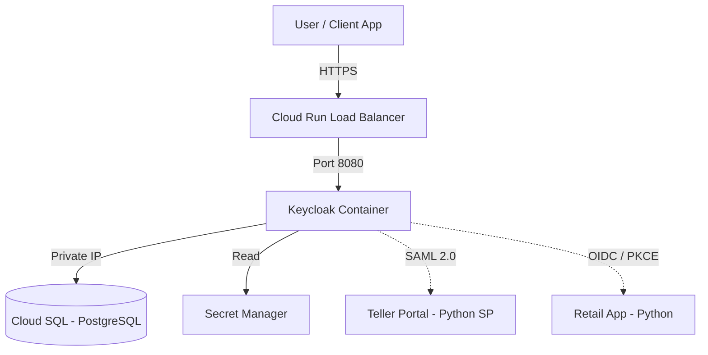

# Architecture - Project 1 (Identity)

**CLASSIFICATION: INTERNAL**

## Topology

## Components

### 1. Keycloak (Application)
*   Runs as a stateless container on Cloud Run.
*   **Startup:** Uses `args = ["start", "--optimized"]` to trigger the production runtime.
*   **Connectivity:** Enforces **Zero-Trust** by using the `cloud-sql-python-connector`. This leverages IAM-based authentication for the database session, ensuring that network proximity alone is insufficient for access.
*   **Optimization:** JDBC pool size is capped (`KC_DB_POOL_MAX_SIZE=20`) to stay within the limits of the `db-f1-micro` database tier.
*   **Observability:** Built-in health checks are enabled via `KC_HEALTH_ENABLED=true`. Cloud Run uses the `/health/live` endpoint for startup probes.
*   **Secrets:** Sensitive variables (DB Password, Admin Password) are mapped directly from Secret Manager into environment variables at the container level.
*   Configured with `KC_PROXY=edge` to handle TLS termination at the load balancer.

### 2. Cloud SQL (Database)
*   Stores Realms, Clients, Users, and Sessions.
*   **Network:** Private IP only (Public IP disabled). Accessed via Private Service Access (VPC Peering).

## Networking: 

### 3. VPC Connector
*   Bridges the Serverless environment (Cloud Run) with the VPC to allow traffic to Cloud SQL.
*   **Egress:** Configured to `all-traffic` to ensure all outbound requests flow through the Cloud NAT gateway (allowing for static IP whitelisting).

### 4. Region and Zone
*   The region and/or zone will be specified at the .tfvars level/files.

### Traffic Flow

#### Ingress (Incoming)
*   **Type:** External (Public Internet).
*   **Mechanism:** Traffic enters via the global Google Cloud Load Balancer (Cloud Run default).
    *   *Decision:* We utilize the built-in shared load balancer for cost efficiency. A dedicated Global External Load Balancer is reserved for future hardening (to enable Cloud Armor WAF).
*   **Termination:** TLS is terminated at the edge. The container receives unencrypted HTTP traffic on port 8080.
*   **Security:** The container is configured with `KC_PROXY=edge` and `KC_HOSTNAME_STRICT=false` to ensure it recognizes the original `https` protocol while allowing for Cloud Run's dynamic service URLs.

#### Egress (Outgoing)
*   **Type:** Internal (Private VPC).
*   **Mechanism:** Forced via Serverless VPC Access Connector (`egress = "all-traffic"`).
*   **Destinations:**
    1.  **Cloud SQL:** Accessed via Private IP (No public internet exposure).
    2.  **External APIs:** Routed through Cloud NAT to ensure a stable static outbound IP.

## IAM & Identity

### Service Account: `keycloak-sa`
*   **Purpose:** Dedicated identity for the Keycloak Cloud Run service. Replaces the default Compute Engine Service Account to enforce Least Privilege.
*   **Configuration:** The Service Account ID is **not** hardcoded in the Terraform module. It is injected via the `keycloak_serv_acc_account_id` variable from the environment-specific `.tfvars` file.
*   **Permissions:**
    *   `roles/cloudsql.client`: Allows connection to Cloud SQL via the Auth Proxy.
    *   `roles/secretmanager.secretAccessor`: Allows retrieval of database and admin credentials.
    *   `roles/artifactregistry.reader`: Allows pulling the container image.

## IAM & Identity

### Service Account: `keycloak-sa`
*   **Purpose:** Dedicated identity for the Keycloak Cloud Run service. Replaces the default Compute Engine Service Account to enforce Least Privilege.
*   **Configuration:** The Service Account ID is **not** hardcoded in the Terraform module. It is injected via the `keycloak_serv_acc_account_id` variable from the environment-specific `.tfvars` file.
*   **Permissions:**
    *   `roles/cloudsql.client`: Allows connection to Cloud SQL via the Auth Proxy.
    *   `roles/secretmanager.secretAccessor`: Allows retrieval of database and admin credentials.
    *   `roles/artifactregistry.reader`: Allows pulling the container image.
    *   `roles/run.admin`: Permission to manage Cloud Run revisions.
    *   `roles/iam.serviceAccountUser`: Required for identity impersonation during deployment.

### 5. Dependency Management
*   **Standard:** Employs `requirements.in` for high-level dependency declarations.
*   **Reproducibility:** Pinned `requirements.txt` files are generated via `pip-compile` to ensure deterministic builds and environment parity across Cloud Run instances.