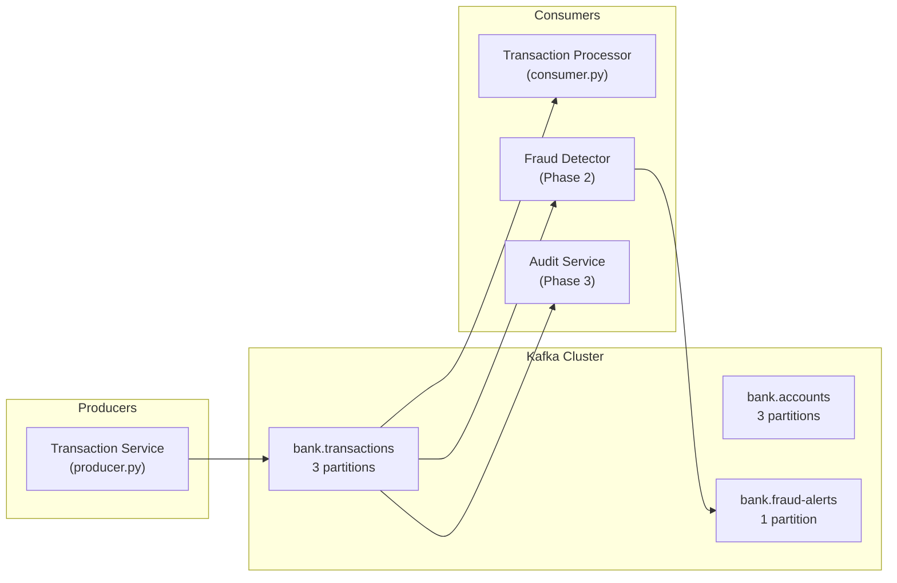

# Kafka Event Streaming Platform — Project 5

> Real-time banking event pipeline & message broker for the Altmtrk2026 Bank Platform.

---

## Architecture



## Quick Start

```bash
# 1. Start Kafka + UI
docker compose up -d

# 2. Install Python dependencies
pip install -r requirements.txt

# 3. Produce mock transactions
python3 src/producer.py --count 50

# 4. Consume & view transactions
python3 src/consumer.py --from-beginning

# 5. Open Kafka UI → http://localhost:8080
```

## Use Cases

- **Real-time Event Streaming** — Fraud detection, risk management, account updates
- **Microservice Communication** — Kafka as the messaging backbone between services
- **Data Pipeline Integration** — Streaming data between banking systems
- **Change Data Capture (CDC)** — Capturing database changes as events

## Project Structure

| Path | Description |
|------|-------------|
| [`docker-compose.yml`](file:///home/pochitawork/InterviewCloud%20Projects/Altmtrk2026/Bank/BNKprojects/5/docker-compose.yml) | Kafka (KRaft) + Kafka UI + topic initializer |
| [`src/producer.py`](file:///home/pochitawork/InterviewCloud%20Projects/Altmtrk2026/Bank/BNKprojects/5/src/producer.py) | Mock transaction event producer |
| [`src/consumer.py`](file:///home/pochitawork/InterviewCloud%20Projects/Altmtrk2026/Bank/BNKprojects/5/src/consumer.py) | Transaction event consumer |
| [`concepts/README.md`](file:///home/pochitawork/InterviewCloud%20Projects/Altmtrk2026/Bank/BNKprojects/5/concepts/README.md) | Core Kafka concepts & learning notes |
| [`interview/kafka_interview_guide.md`](file:///home/pochitawork/InterviewCloud%20Projects/Altmtrk2026/Bank/BNKprojects/5/interview/kafka_interview_guide.md) | Interview prep: Q&A, scenarios, talking points |

## Phased Roadmap

| Phase | Focus | Status |
|-------|-------|--------|
| **1** | Kafka fundamentals, local deployment, producer/consumer | ✅ Built |
| **2** | Multi-topic pipeline, fraud detection, schemas, DLQ | ⏳ Next |
| **3** | Microservice integration (Projects 1 & 4), monitoring | 📋 Planned |

## Related Projects

- [Project 1 — Identity Service (Keycloak)](file:///home/pochitawork/InterviewCloud%20Projects/Altmtrk2026/Bank/BNKprojects/1/README.md) — Auth event streaming
- [Project 4 — Actimize AML & Fraud](file:///home/pochitawork/InterviewCloud%20Projects/Altmtrk2026/Bank/BNKprojects/4/Actimize.md) — Fraud alert pipeline
