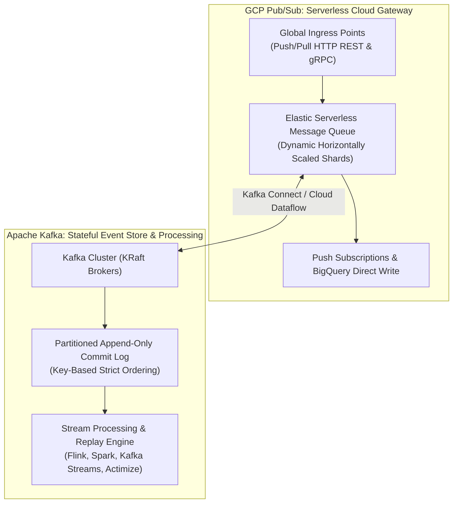
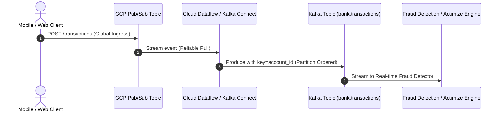
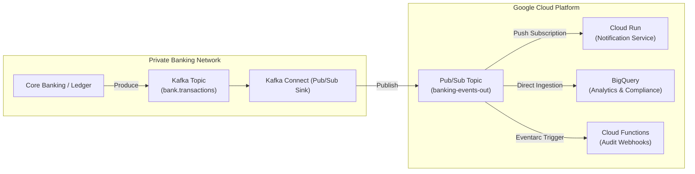

+++
title = "GCP Pub/Sub & Apache Kafka: Complementary Architecture Guide"
domain = "event-streaming"
topics = ["pubsub", "gcp", "kafka", "event-streaming", "architecture", "hybrid-cloud", "banking", "dataflow"]
difficulty = "intermediate"
parent = "README.md"
children = []
related = [
    "README.md",
    "PROJECT5_DETAILS.md",
    "CHECKLIST.md",
    "TODO.md",
    "SECURITY.md",
    "Kafka_in_Banking.md",
    "concepts/README.md"
]
updated_by = "AI Context Specialist"
version = "1.1"
+++

> **Parent**: [`README.md`](file:///home/pochitawork/InterviewCloudProjects/Altmtrk2026/Bank/BNKprojects/5/README.md)  
> **Project Overview**: [`PROJECT5_DETAILS.md`](file:///home/pochitawork/InterviewCloudProjects/Altmtrk2026/Bank/BNKprojects/5/PROJECT5_DETAILS.md)  
> **Implementation Checklist**: [`CHECKLIST.md`](file:///home/pochitawork/InterviewCloudProjects/Altmtrk2026/Bank/BNKprojects/5/CHECKLIST.md)  
> **Actionable Backlog**: [`TODO.md`](file:///home/pochitawork/InterviewCloudProjects/Altmtrk2026/Bank/BNKprojects/5/TODO.md)

---

# GCP Pub/Sub & Apache Kafka: Complementary Architecture in Banking

**CLASSIFICATION: INTERNAL**

## Executive Summary

**Is Google Cloud Pub/Sub complementary to Apache Kafka?**  
**Yes.** While both technologies implement publish-subscribe messaging patterns, they were designed around fundamentally different architectural models and trade-offs. In modern enterprise banking platforms, they are not mutually exclusive competitors; rather, they form a powerful **hybrid messaging tier**:

*   **Apache Kafka** acts as the **Stateful Event Log & Stream Processing Backbone** (deterministic key-based partition ordering, event sourcing, replayability, and heavy real-time stream processing).
*   **Google Cloud Pub/Sub** acts as the **Serverless Global Ingestion & Cloud Egress Gateway** (zero-maintenance auto-scaling, global multi-region endpoints, push-based webhook delivery, and seamless native GCP service integration).

---

## 1. High-Level Architectural Comparison



| Dimension | Apache Kafka (Project 5) | Google Cloud Pub/Sub |
| :--- | :--- | :--- |
| **Architectural Model** | Distributed append-only commit log (partitioned) | Serverless global distributed messaging queue |
| **Consumption Model** | **Pull-based** via Consumer Groups tracking offsets | **Push & Pull** (HTTP Webhooks, Cloud Run, gRPC) |
| **Message Ordering** | **Strict per-partition ordering** by message key | **Per-ordering-key** support (dynamic sharding) |
| **Data Retention & Replay** | **Configurable retention** (days/years/infinite); replay any offset | Retained up to 31 days (Seek available, but not designed as event store) |
| **Operational Overhead** | Requires broker provisioning, capacity planning, partition management | **Zero infrastructure management** (fully serverless, auto-scales to millions of msg/s) |
| **Stream Processing** | Native rich ecosystem (Kafka Streams, ksqlDB, Apache Flink) | Stateless transformations or via Apache Beam / Cloud Dataflow |
| **Native Integrations** | On-premise mainframes, relational CDC (Debezium), core banking | GCP Services (Cloud Run, Cloud Functions, BigQuery, Cloud Storage) |

---

## 2. How GCP Pub/Sub & Kafka Work Together

In enterprise architectures, data flows between Pub/Sub and Kafka using bidirectional connectors (such as **Kafka Connect with Google Cloud Pub/Sub Connector** or **Google Cloud Dataflow / Apache Beam pipelines**).

### Pattern A: Edge Ingress Gateway (Pub/Sub $\to$ Kafka)

External third parties, mobile banking apps, and ATM networks publish events to GCP Pub/Sub. Pub/Sub absorbs spiky traffic without capacity management and buffers events before feeding the internal Kafka streaming engine.



1. **Global Ingress**: Public clients publish to a regional/global Pub/Sub topic authenticated via Google Cloud IAM or OAuth2.
2. **Buffer & Decoupling**: Pub/Sub scales instantaneously to absorb sudden transaction bursts or DDoS attempts without risking Kafka broker connection exhaustion.
3. **Ordered Ingestion**: Kafka Connect consumes from Pub/Sub and produces to Kafka topic `bank.transactions`, hashing by `account_id` so all events for a given account land in the same partition.
4. **Stateful Processing**: Fraud detection engines (e.g. Actimize, Project 4) process the ordered stream with exact-once semantics.

---

### Pattern B: Core Event Log to Serverless Egress & Analytics (Kafka $\to$ Pub/Sub)

Core banking transactions and ledger updates generated inside the private VPC are published to Kafka. Events are then forwarded to Pub/Sub to trigger serverless microservices and populate GCP BigQuery data warehouses.



1. **Transaction Finality**: The core transaction service commits transactions to the Kafka log (`bank.transactions`).
2. **Sink Connector**: Kafka Connect publishes completed transaction events to Google Cloud Pub/Sub.
3. **Serverless Fan-out**:
   *   **Cloud Run Notification Service**: Pub/Sub pushes events directly via HTTP to send SMS/Email notifications to customers.
   *   **BigQuery Direct Streaming**: A BigQuery subscription routes raw events into partitioned analytics tables without writing worker code.
   *   **Cloud Functions / Eventarc**: Triggers async compliance and audit workflows.

---

### Pattern C: Hybrid Cloud & On-Premise to Cloud Bridge

Many tier-1 banks operate on-premise Kafka clusters in private datacenters while building modern customer-facing services on Google Cloud.

```mermaid
graph LR
    subgraph On-Premise Data Center
        Mainframe["Mainframe / Core DB"] -->|CDC Debezium| K_OnPrem["On-Premise Kafka Cluster"]
    end

    subgraph Google Cloud Platform
        Bridge["MirrorMaker / Dataflow / Connect"]
        K_OnPrem -->|Secure Egress (Cloud Interconnect)| Bridge
        Bridge --> PS_GCP["GCP Pub/Sub Topics"]
        PS_GCP --> App1["Cloud Run Microservices"]
        PS_GCP --> App2["Keycloak / Identity (Project 1)"]
        PS_GCP --> App3["Transaction Journeys (Project 2)"]
    end
```

---

## 3. Concrete Implementation Blueprint for Project 5

### 3.1 Pub/Sub Topic Topology

| GCP Pub/Sub Topic | Ingress Source | Target Kafka Topic | Dead Letter Topic (DLT) |
| :--- | :--- | :--- | :--- |
| `bnk-tx-ingress-topic` | Mobile Apps / Edge Gateways | `bank.transactions` | `bnk-tx-ingress-dlt` |
| `bnk-partner-ingress-topic` | MuleSoft (Project 7) Partner APIs | `bank.transactions` | `bnk-partner-ingress-dlt` |
| `bnk-auth-telemetry-topic` | Keycloak (Project 1) Log Drains | `bank.auth-events` | `bnk-auth-telemetry-dlt` |
| `bnk-analytics-egress-topic` | Kafka Connect Sink | Google BigQuery Streaming Table | `bnk-analytics-dlt` |

### 3.2 Dead Letter Topic (DLT) & Retry Policy
*   **Max Delivery Attempts**: `5`
*   **Backoff Delay**: Exponential (minimum 10s, maximum 600s)
*   **Dead Letter Destination**: Malformed or unprocessable payloads automatically route to the corresponding `-dlt` topic with custom user attributes:
    *   `CloudPubSubDeadLetterSourceDeliveryAttempt`
    *   `CloudPubSubDeadLetterSourceSubscription`
    *   `CloudPubSubDeadLetterSourceTopic`
*   **Alerting**: Cloud Monitoring alerts trigger if DLT queue depth exceeds `0` unacknowledged messages.

### 3.3 Security & IAM Permissions
*   **Service Account Isolation**: Dedicated service account `sa-pubsub-kafka-bridge@${PROJECT_ID}.iam.gserviceaccount.com`.
*   **Least Privilege Roles**:
    *   `roles/pubsub.subscriber` on Ingress Topics
    *   `roles/pubsub.publisher` on Egress & Dead-Letter Topics
    *   `roles/secretmanager.secretAccessor` for retrieving Kafka SASL/TLS truststore certificates.

---

## 4. Architectural Decision Matrix: When to Use Which?

```
                                  Decision Tree
                                        │
                    Is this event processing within GCP
                    and targeting serverless services?
                                  ┌─────┴─────┐
                                 YES          NO
                                  │            │
                    Needs event replay or      │
                    strict stream state?       │
                         ┌────────┴────────┐   │
                        YES               NO   │
                         │                 │   │
                         ▼                 ▼   ▼
                   [APACHE KAFKA]    [GCP PUB/SUB]
                (or Pub/Sub -> Kafka)
```

| Scenario in Altmtrk2026 Bank Platform | Recommended Technology | Rationale |
| :--- | :--- | :--- |
| **Real-time Transaction Ledger & Account Balances** | **Apache Kafka** | Requires key-based partition ordering by `account_id` and immutable offset replay. |
| **Real-time AML & Fraud Rules Engine (Actimize)** | **Apache Kafka** | Requires stateful stream processing with sliding time-window aggregations. |
| **Customer Push Notifications (SMS/Email)** | **GCP Pub/Sub** | Push subscriptions trigger serverless Cloud Run workers on-demand. |
| **Public API Webhook Ingress (Partner Banks / Stripe)** | **GCP Pub/Sub** | Elastic global endpoints with zero capacity planning. |
| **Financial Audit Log Streaming to BigQuery** | **Pub/Sub $\to$ BigQuery** | Native serverless direct write to BigQuery storage. |
| **Database Change Data Capture (CDC via Debezium)** | **Apache Kafka** | Low-latency commit log streaming from PostgreSQL/MongoDB. |

---

## 5. Related Documentation

*   [`README.md`](file:///home/pochitawork/InterviewCloudProjects/Altmtrk2026/Bank/BNKprojects/5/README.md) — Master navigation hub
*   [`PROJECT5_DETAILS.md`](file:///home/pochitawork/InterviewCloudProjects/Altmtrk2026/Bank/BNKprojects/5/PROJECT5_DETAILS.md) — Technical specifications & RACI matrix
*   [`CHECKLIST.md`](file:///home/pochitawork/InterviewCloudProjects/Altmtrk2026/Bank/BNKprojects/5/CHECKLIST.md) — Implementation checklist
*   [`TODO.md`](file:///home/pochitawork/InterviewCloudProjects/Altmtrk2026/Bank/BNKprojects/5/TODO.md) — Actionable task backlog
*   [`SECURITY.md`](file:///home/pochitawork/InterviewCloudProjects/Altmtrk2026/Bank/BNKprojects/5/SECURITY.md) — Security & zero-trust policy
