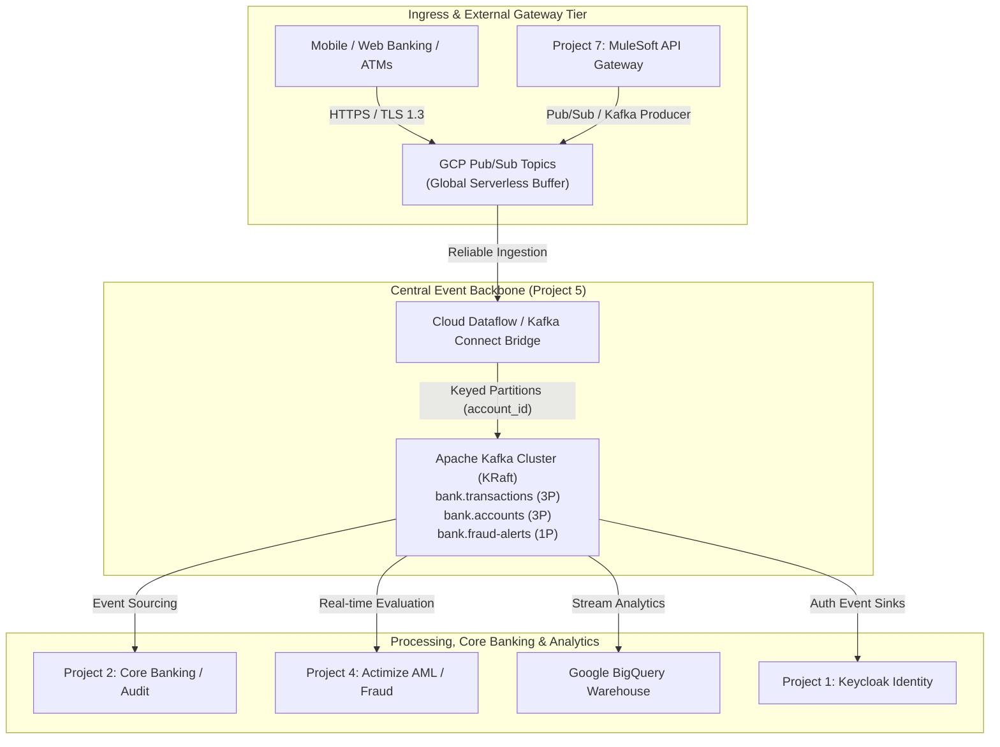

+++
title = "Project 5: Kafka & GCP Pub/Sub Event Streaming Platform"
domain = "event-streaming"
topics = ["kafka", "pubsub", "event-streaming", "event-driven", "messaging", "gcp", "fraud-detection", "cdc"]
difficulty = "intermediate"
parent = "../README.md"
children = [
    "PROJECT5_DETAILS.md",
    "PUBSUB.md",
    "CHECKLIST.md",
    "TODO.md",
    "SECURITY.md",
    "AGENTS.md",
    "Kafka_in_Banking.md",
    "concepts/README.md",
    "interview/kafka_interview_guide.md"
]
related = [
    "../1/README.md",
    "../2/PROJECT_DETAILS.md",
    "../4/Actimize.md",
    "../6/README.md",
    "../7/README.md",
    "../../Documentation/internal/Architecture.md",
    "../../Documentation/internal/INFRASTRUCTURE.md",
    "../../Documentation/internal/SECURITY.md"
]
updated_by = "AI Context Specialist"
version = "1.1"
+++

> **Parent**: [`../README.md`](file:///home/pochitawork/InterviewCloudProjects/Altmtrk2026/Bank/BNKprojects/README.md)  
> **Global Agent Protocols**: [`Documentation/internal/AGENTS.md`](file:///home/pochitawork/InterviewCloudProjects/Altmtrk2026/Bank/Documentation/internal/AGENTS.md)  
> **Security Directives**: [`SECURITY.md`](file:///home/pochitawork/InterviewCloudProjects/Altmtrk2026/Bank/BNKprojects/5/SECURITY.md)  
> **Pub/Sub Guide**: [`PUBSUB.md`](file:///home/pochitawork/InterviewCloudProjects/Altmtrk2026/Bank/BNKprojects/5/PUBSUB.md)

---

# Project 5: Event Streaming Platform (`BNKprojects/5/`)

Project 5 is the central real-time event streaming and messaging backbone of the Altmtrk2026 Bank Platform. It provides a scalable, decoupled, and durable event architecture combining **Apache Kafka** (stateful event log & stream processing) and **Google Cloud Pub/Sub** (serverless edge ingress & cloud fan-out).

**Status:** Active / Phase 1 Complete (Local KRaft Pipeline) — Phase 2 & 3 in Planning  
**Primary Technologies:** Apache Kafka 3.8 (KRaft mode), Google Cloud Pub/Sub, Python 3.11 (`confluent-kafka`), Kafka UI, GCP Cloud Dataflow / Kafka Connect  

---

## 1. System Overview & Topology



---

## 2. Documentation Map & Navigation

| Document | Purpose | Audience / When to Use |
| :--- | :--- | :--- |
| **[`PROJECT5_DETAILS.md`](file:///home/pochitawork/InterviewCloudProjects/Altmtrk2026/Bank/BNKprojects/5/PROJECT5_DETAILS.md)** | Deep-dive technical specifications, topic schemas, partition strategies, and RACI matrix | System design, infrastructure reviews, and integration planning |
| **[`PUBSUB.md`](file:///home/pochitawork/InterviewCloudProjects/Altmtrk2026/Bank/BNKprojects/5/PUBSUB.md)** | Hybrid architecture guide for GCP Pub/Sub + Kafka bridging and edge ingress | Ingress design, serverless pipelines, and Pub/Sub integrations |
| **[`CHECKLIST.md`](file:///home/pochitawork/InterviewCloudProjects/Altmtrk2026/Bank/BNKprojects/5/CHECKLIST.md)** | Phased milestone tracker from local setup to multi-region production deployment | Tracking progress, delivery milestones, and sign-offs |
| **[`TODO.md`](file:///home/pochitawork/InterviewCloudProjects/Altmtrk2026/Bank/BNKprojects/5/TODO.md)** | Granular engineering task backlog with priority tags, blockers, and acceptance criteria | Daily sprint planning and AI task execution |
| **[`SECURITY.md`](file:///home/pochitawork/InterviewCloudProjects/Altmtrk2026/Bank/BNKprojects/5/SECURITY.md)** | Zero-trust access, SASL/SCRAM, TLS encryption, Kafka ACLs, and PCI-DSS log masking | Security compliance and credential management |
| **[`AGENTS.md`](file:///home/pochitawork/InterviewCloudProjects/Altmtrk2026/Bank/BNKprojects/5/AGENTS.md)** | Protocols, safety guardrails, and execution rules for automated agents and bots | AI assistant and CI/CD bot tasks |
| **[`Kafka_in_Banking.md`](file:///home/pochitawork/InterviewCloudProjects/Altmtrk2026/Bank/BNKprojects/5/Kafka_in_Banking.md)** | High-level overview, quick start, and banking event-driven patterns | Quick onboarding and domain introduction |
| **[`concepts/README.md`](file:///home/pochitawork/InterviewCloudProjects/Altmtrk2026/Bank/BNKprojects/5/concepts/README.md)** | Deep dive into Kafka core concepts (partitions, offsets, consumer groups, KRaft) | Educational onboarding and learning |
| **[`interview/kafka_interview_guide.md`](file:///home/pochitawork/InterviewCloudProjects/Altmtrk2026/Bank/BNKprojects/5/interview/kafka_interview_guide.md)** | Comprehensive technical interview prep and architectural Q&A scenarios | Interview rehearsal and architectural defense |

---


## 3. Quick Start (Local KRaft Sandbox)

```bash
# 1. Navigate to Project 5
cd /home/pochitawork/InterviewCloudProjects/Altmtrk2026/Bank/BNKprojects/5

# 2. Launch KRaft Kafka Broker + Kafka UI + Topic Initializer
docker compose up -d

# 3. Verify running containers
docker compose ps

# 4. Install client dependencies in a virtual environment
pip install -r requirements.txt

# 5. Produce 50 sample banking transaction events
python3 src/producer.py --count 50

# 6. Consume and process transactions from the beginning
python3 src/consumer.py --from-beginning

# 7. Access Kafka Web UI for visual stream inspection
# Open browser at: http://localhost:8080
```

---


## 4. Topic Taxonomy & Guarantees

| Topic Name | Partitions | Key Strategy | Ordering Scope | Delivery Guarantee | Retention |
| :--- | :--- | :--- | :--- | :--- | :--- |
| `bank.transactions` | 3 | `account_id` | Strict per-account ordering | At-least-once (manual offset commit) | 7 days (168h) |
| `bank.accounts` | 3 | `account_id` | Strict per-account ordering | At-least-once | 30 days (compacted) |
| `bank.fraud-alerts` | 1 | `alert_id` | Total global ordering | At-least-once | 90 days |
| `bank.dead-letter` | 3 | `original_topic` | Partition level | At-least-once | 14 days |

---


## 5. Integration with Bank Ecosystem

*   **Project 1 (Keycloak Identity)**: Streams authentication logs and security token events (`bank.auth-events`).
*   **Project 2 (Transaction Service)**: Produces core money transfer records and writes audit logs to MongoDB.
*   **Project 4 (NICE Actimize)**: Subscribes to `bank.transactions` in real time to perform AML anomaly scoring and emits alerts to `bank.fraud-alerts`.
*   **Project 6 (ArgoCD)**: Manages declarative Kubernetes manifests (Strimzi Kafka Operator) on GKE.
*   **Project 7 (MuleSoft)**: Ingests third-party partner payloads, normalizes JSON via DataWeave, and publishes to GCP Pub/Sub & Kafka.

---


<!-- AI RETRIEVAL TRIGGERS:
- Where is Kafka event streaming documented? -> BNKprojects/5/README.md
- Where is GCP Pub/Sub integration planning documented? -> BNKprojects/5/PUBSUB.md
- Where are Project 5 technical specifications and RACI matrix? -> BNKprojects/5/PROJECT5_DETAILS.md
- Where is the Project 5 implementation checklist? -> BNKprojects/5/CHECKLIST.md
- Where is the Project 5 todo list? -> BNKprojects/5/TODO.md
- How to start local Kafka environment? -> BNKprojects/5/README.md # Quick Start
-->
