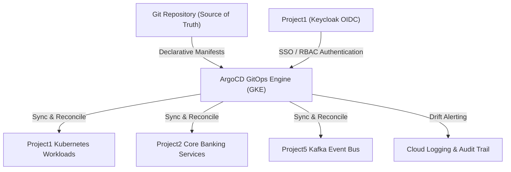

+++
title = "Project6: ArgoCD GitOps Engine"
domain = "gitops"
topics = ["argocd", "kubernetes", "gke", "gitops", "continuous-delivery", "drift-detection"]
difficulty = "advanced"
parent = "../README.md"
children = [
    "PROJECT6_DETAILS.md",
    "SECURITY.md",
    "AGENTS.md",
    "CHECKLIST.md",
    "bootstrap/README.md",
    "apps/README.md",
    "manifests/README.md",
    "plugins/README.md",
    "scripts/README.md"
]
related = ["../1/README.md", "../2/PROJECT_DETAILS.md", "../5/Kafka_in_Banking.md", "../../Documentation/internal/AGENTS.md"]
updated_by = "AI Knowledge Engineer"
version = "1.0"
+++

> **Parent**: [`../README.md`](file:///home/pochitawork/InterviewCloud%20Projects/Altmtrk2026/Bank/BNKprojects/README.md)  
> **Global Policy**: [`Documentation/internal/AGENTS.md`](file:///home/pochitawork/InterviewCloud%20Projects/Altmtrk2026/Bank/Documentation/internal/AGENTS.md)  
> **Security Directives**: [`SECURITY.md`](file:///home/pochitawork/InterviewCloud%20Projects/Altmtrk2026/Bank/BNKprojects/6/SECURITY.md)

---

# Project 6: ArgoCD GitOps Engine (`BNKprojects/6/`)

## Executive Summary

Project6 establishes the declarative **GitOps Continuous Delivery and Drift Detection Engine** for the Altmtrk2026 Bank Platform using **ArgoCD** hosted on Google Kubernetes Engine (GKE Autopilot).

While Google Cloud Deploy handles containerized serverless deployments (Cloud Run), ArgoCD serves as the Kubernetes-native control plane for container orchestration, managing declarative cluster state, automated sync, drift detection, and secret-managed application deployments.

---

## Architecture Topology

---

## Directory Navigation & Structure Map

| Directory / File | Description & Scope | Primary Document / Sub-Index |
| :--- | :--- | :--- |
| **`PROJECT6_DETAILS.md`** | Deep-dive architecture, App-of-Apps pattern, and hybrid delivery strategy | [`PROJECT6_DETAILS.md`](file:///home/pochitawork/InterviewCloud%20Projects/Altmtrk2026/Bank/BNKprojects/6/PROJECT6_DETAILS.md) |
| **`SECURITY.md`** | Zero-trust security, OIDC SSO, RBAC mapping, SOPS/Sealed Secrets policies | [`SECURITY.md`](file:///home/pochitawork/InterviewCloud%20Projects/Altmtrk2026/Bank/BNKprojects/6/SECURITY.md) |
| **`AGENTS.md`** | AI Agent operating rules and protocols specific to Project 6 | [`AGENTS.md`](file:///home/pochitawork/InterviewCloud%20Projects/Altmtrk2026/Bank/BNKprojects/6/AGENTS.md) |
| **`CHECKLIST.md`** | Implementation milestones, quality gates, and verification checklists | [`CHECKLIST.md`](file:///home/pochitawork/InterviewCloud%20Projects/Altmtrk2026/Bank/BNKprojects/6/CHECKLIST.md) |
| **`bootstrap/`** | Core ArgoCD installation & GKE Autopilot base manifests | [`bootstrap/README.md`](file:///home/pochitawork/InterviewCloud%20Projects/Altmtrk2026/Bank/BNKprojects/6/bootstrap/README.md) |
| **`apps/`** | ArgoCD Application definitions using the "App of Apps" pattern | [`apps/README.md`](file:///home/pochitawork/InterviewCloud%20Projects/Altmtrk2026/Bank/BNKprojects/6/apps/README.md) |
| **`manifests/`** | Declarative Kustomize & Helm Kubernetes workload manifests | [`manifests/README.md`](file:///home/pochitawork/InterviewCloud%20Projects/Altmtrk2026/Bank/BNKprojects/6/manifests/README.md) |
| **`plugins/`** | Config Management Plugins (CMP) for secret decryption (SOPS/KSOPS) | [`plugins/README.md`](file:///home/pochitawork/InterviewCloud%20Projects/Altmtrk2026/Bank/BNKprojects/6/plugins/README.md) |
| **`scripts/`** | Cluster installation, validation, and sync status inspection utilities | [`scripts/README.md`](file:///home/pochitawork/InterviewCloud%20Projects/Altmtrk2026/Bank/BNKprojects/6/scripts/README.md) |

---

## AI Retrieval & Navigation Guidance

### Why Retrieve This Document?
- To understand the high-level purpose and directory organization of Project6 (ArgoCD GitOps).
- To locate specific child documentation for security, architecture, agents, or bootstrap procedures.

### When NOT to Retrieve This Document?
- When troubleshooting specific Keycloak OIDC issues (see [`BNKprojects/1/README.md`](file:///home/pochitawork/InterviewCloud%20Projects/Altmtrk2026/Bank/BNKprojects/1/README.md)).
- When configuring Terraform foundation resources (see [`terraform/README.md`](file:///home/pochitawork/InterviewCloud%20Projects/Altmtrk2026/Bank/terraform/README.md)).

### Prerequisites
- Knowledge of Kubernetes declarative manifests and GitOps principles.
- Familiarity with the platform's Security Directive ([`Documentation/internal/SECURITY.md`](file:///home/pochitawork/InterviewCloud%20Projects/Altmtrk2026/Bank/Documentation/internal/SECURITY.md)).

### Recommended Next Reading
1. [`PROJECT6_DETAILS.md`](file:///home/pochitawork/InterviewCloud%20Projects/Altmtrk2026/Bank/BNKprojects/6/PROJECT6_DETAILS.md) - Deep-dive technical specifications.
2. [`SECURITY.md`](file:///home/pochitawork/InterviewCloud%20Projects/Altmtrk2026/Bank/BNKprojects/6/SECURITY.md) - Zero-Trust GitOps security model.
