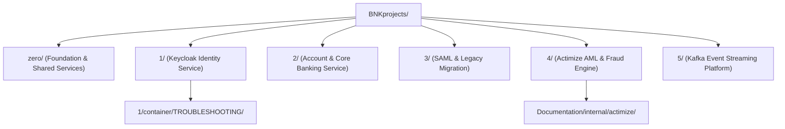

+++
title = "Banking Microservices Index"
domain = "microservices"
topics = ["index", "keycloak", "actimize", "kafka", "projects"]
difficulty = "intermediate"
parent = "../README.md"
children = [
    "zero/README.md",
    "1/README.md",
    "2/PROJECT_DETAILS.md",
    "3/README.md",
    "4/Actimize.md",
    "5/Kafka_in_Banking.md"
]
related = ["../terraform/README.md", "../Documentation/internal/README.md"]
updated_by = "AI Context Specialist"
version = "1.0"
+++

> **Parent**: [`../README.md`](file:///home/pochitawork/InterviewCloud%20Projects/Altmtrk2026/Bank/README.md)  
> **Related Infrastructure**: [`terraform/README.md`](file:///home/pochitawork/InterviewCloud%20Projects/Altmtrk2026/Bank/terraform/README.md)

---

# Banking Microservices Index (`BNKprojects/`)

This directory houses the individual application services and domain modules of the Altmtrk2026 Bank Platform.

## Microservices Topology

## Microservice Catalog

| Project ID | Service Name | Core Tech Stack | Description & Primary Documentation |
| :--- | :--- | :--- | :--- |
| **Project 0** | Foundation / Base Config | Shared Configs | Base foundational definitions and identity contracts. [`zero/README.md`](file:///home/pochitawork/InterviewCloud%20Projects/Altmtrk2026/Bank/BNKprojects/zero/README.md) |
| **Project 1** | Identity Service | Keycloak, Docker, Python | OIDC Identity Provider, Keycloak deployment, authentication tests. [`1/README.md`](file:///home/pochitawork/InterviewCloud%20Projects/Altmtrk2026/Bank/BNKprojects/1/README.md) |
| **Project 2** | Core Banking Backend | Containers, Microservices | Core banking business logic and account management. [`2/PROJECT_DETAILS.md`](file:///home/pochitawork/InterviewCloud%20Projects/Altmtrk2026/Bank/BNKprojects/2/PROJECT_DETAILS.md) |
| **Project 3** | SAML & Identity Migration | Keycloak, SAML 2.0 | Migration of legacy auth protocols to SAML 2.0 & OIDC. [`3/README.md`](file:///home/pochitawork/InterviewCloud%20Projects/Altmtrk2026/Bank/BNKprojects/3/README.md) |
| **Project 4** | Actimize AML & Fraud | Actimize Engine | Anti-money laundering & transaction monitoring engine. [`4/Actimize.md`](file:///home/pochitawork/InterviewCloud%20Projects/Altmtrk2026/Bank/BNKprojects/4/Actimize.md) |
| **Project 5** | Event Streaming | Apache Kafka, Zookeeper | Real-time banking event pipeline & message broker. [`5/Kafka_in_Banking.md`](file:///home/pochitawork/InterviewCloud%20Projects/Altmtrk2026/Bank/BNKprojects/5/Kafka_in_Banking.md) |

---

<!-- AI RETRIEVAL TRIGGERS:
- Where is Keycloak authentication located? -> BNKprojects/1/README.md
- Where is Kafka event streaming documented? -> BNKprojects/5/Kafka_in_Banking.md
- How to troubleshoot Project 1 containers? -> BNKprojects/1/container/TROUBLESHOOTING/TROUBLESHOOTING.md
-->
