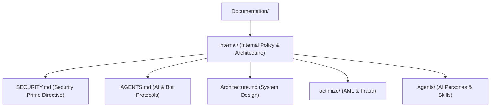

+++
title = "Documentation Navigation Hub"
domain = "documentation"
topics = ["index", "navigation", "internal", "architecture", "security"]
difficulty = "beginner"
parent = "../README.md"
children = ["internal/README.md"]
related = ["../BNKprojects/README.md", "../terraform/README.md"]
updated_by = "AI Documentation Specialist"
version = "1.0"
+++

> **Parent**: [`README.md`](file:///home/pochitawork/InterviewCloud%20Projects/Altmtrk2026/Bank/README.md)  
> **Children**: [`internal/README.md`](file:///home/pochitawork/InterviewCloud%20Projects/Altmtrk2026/Bank/Documentation/internal/README.md)  
> **Related**: [`BNKprojects/README.md`](file:///home/pochitawork/InterviewCloud%20Projects/Altmtrk2026/Bank/BNKprojects/README.md), [`terraform/README.md`](file:///home/pochitawork/InterviewCloud%20Projects/Altmtrk2026/Bank/terraform/README.md)

---

# Documentation Hub

Welcome to the central documentation hub for the **Altmtrk2026 Bank Platform**.

## Purpose & Scope
This directory houses all internal architectural guidelines, security policies, AI agent specifications, operational runbooks, and domain knowledge.

## Quick Navigation

## Section Index

| Section | Description | Key File |
| :--- | :--- | :--- |
| **Internal Directives** | Security, Architecture, Testing, Contributing policies | [`internal/README.md`](file:///home/pochitawork/InterviewCloud%20Projects/Altmtrk2026/Bank/Documentation/internal/README.md) |
| **AI Agent Protocols** | Instructions for AI assistants (Antigravity, Gemini, Gemma) | [`internal/AGENTS.md`](file:///home/pochitawork/InterviewCloud%20Projects/Altmtrk2026/Bank/Documentation/internal/AGENTS.md) |
| **Security Prime Directive** | Zero-trust mandates and access controls | [`internal/SECURITY.md`](file:///home/pochitawork/InterviewCloud%20Projects/Altmtrk2026/Bank/Documentation/internal/SECURITY.md) |
| **Actimize Integration** | AML, fraud prevention, and transaction monitoring | [`internal/actimize/README.md`](file:///home/pochitawork/InterviewCloud%20Projects/Altmtrk2026/Bank/Documentation/internal/actimize/README.md) |
