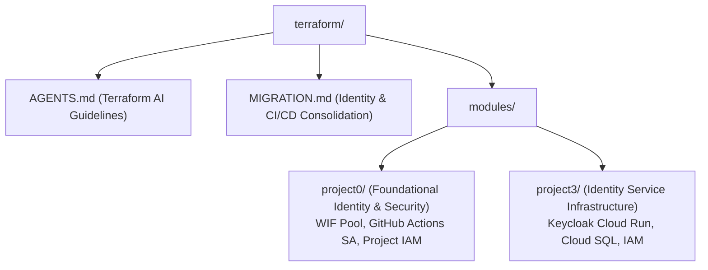

+++
title = "Terraform Infrastructure Navigation Hub"
domain = "terraform"
topics = ["index", "gcp", "terraform", "workload-identity", "modules"]
difficulty = "intermediate"
parent = "../README.md"
children = [
    "AGENTS.md",
    "MIGRATION.md",
    "modules/project0/README.md",
    "modules/project3/IdentityConfig_TS.md"
]
related = ["../Documentation/internal/INFRASTRUCTURE.md", "../BNKprojects/README.md"]
updated_by = "AI Context Specialist"
version = "1.0"
+++

> **Parent**: [`../README.md`](file:///home/pochitawork/InterviewCloud%20Projects/Altmtrk2026/Bank/README.md)  
> **Infrastructure Policy**: [`../Documentation/internal/INFRASTRUCTURE.md`](file:///home/pochitawork/InterviewCloud%20Projects/Altmtrk2026/Bank/Documentation/internal/INFRASTRUCTURE.md)

---

# Terraform Infrastructure Hub

This directory contains the Infrastructure-as-Code (IaC) declarations for the Altmtrk2026 Bank Platform on Google Cloud Platform (GCP).

## Architecture & Module Hierarchy

## Documentation & Modules Index

| Location | Purpose | Key Content |
| :--- | :--- | :--- |
| [`AGENTS.md`](file:///home/pochitawork/InterviewCloud%20Projects/Altmtrk2026/Bank/terraform/AGENTS.md) | **Terraform Agent Rules** | Variable constraints, working directory rules, IAM explicit resource policies. |
| [`MIGRATION.md`](file:///home/pochitawork/InterviewCloud%20Projects/Altmtrk2026/Bank/terraform/MIGRATION.md) | **Migration Guide** | Centralizing identity into `modules/project0`. |
| [`modules/project0/README.md`](file:///home/pochitawork/InterviewCloud%20Projects/Altmtrk2026/Bank/terraform/modules/project0/README.md) | **Project 0 Module** | Foundational IAM, Service Accounts, Workload Identity Federation. |
| [`modules/project0/TROUBLESHOOTING_PROJECT0.md`](file:///home/pochitawork/InterviewCloud%20Projects/Altmtrk2026/Bank/terraform/modules/project0/TROUBLESHOOTING_PROJECT0.md) | **Project 0 TS** | WIF permissions, IAM binding troubleshooting. |
| [`modules/project3/IdentityConfig_TS.md`](file:///home/pochitawork/InterviewCloud%20Projects/Altmtrk2026/Bank/terraform/modules/project3/IdentityConfig_TS.md) | **Project 3 TS** | Keycloak infrastructure & 403 Forbidden troubleshooting. |

---

<!-- AI RETRIEVAL TRIGGERS:
- How to configure Workload Identity Federation in Terraform? -> terraform/modules/project0/README.md
- What are the Terraform agent rules? -> terraform/AGENTS.md
- How to fix Keycloak Cloud Run 403 error? -> terraform/modules/project3/ERROR_403_EXPLANATION.md
-->
